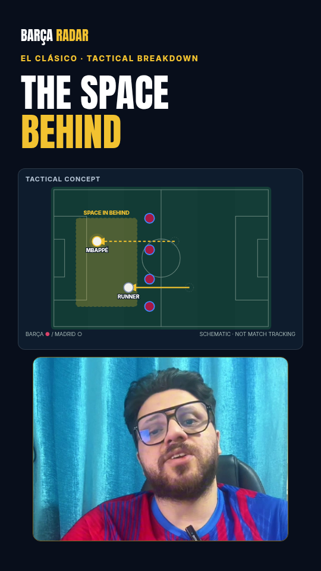

# El Clásico — source-aligned tactical Short

## Authoritative content

The user explicitly selected the **actual presenter recording**, not the previously supplied PSG or historical scripts. The 175-second square recording is the Short source. It opens “Losing El Clásico is always tough to swallow…” and discusses Madrid's press, Barcelona's high line, wide traps, injuries, a corner, substitutions and Gerard Martín's late block.

The uploaded Persian historical video (96.731s, 720×1280) is a **style reference only**. No footage or audio from it is included in this edit. It is not a presenter source, and the historical script is not used. The earlier PSG packet remains a separate archived planning exercise.

## Implementation

- Spec: [`studio/src/episodes-source/clasico-source.spec.json`](../../../studio/src/episodes-source/clasico-source.spec.json) — scenes, boards, cards, chapters, cover. Rendered by the shared engine `studio/src/production/source/SourceEpisode.tsx`.
- `CLASICO-SOURCE-SHORT`: 1080×1920, 30fps, 5250 frames / 175s.
- `CLASICO-SOURCE-LONG`: 1920×1080, 30fps, 5850 frames / 195s (175s analysis + 20s end screen), 9 YouTube chapters. Posting: [posting-long.en.md](posting-long.en.md).
- Clip Shorts from the same take, cut on scene (sentence) boundaries: `CLASICO-SOURCE-CLIP-PRESS` (11.84–50.66s, Madrid's press), `CLASICO-SOURCE-CLIP-HIGH-LINE` (50.66–82.62s, high line and wide trap), `CLASICO-SOURCE-CLIP-MARTIN` (152.8–175s, the goals and Martín's block).
- Stills: `CLASICO-SOURCE-COVER` (vertical) and `CLASICO-SOURCE-THUMB` (1280×720).
- Same speaking rate and timeline as the original; no automatic pause/retake removal.
- Original presenter framed below source-relevant motion plates, with semantic section changes and word-timed captions.
- Original schematic tactical illustrations, not measured match tracking. No invented date, result, xG or player-route measurements.
- Local licensed fonts; high-pass and two-pass voice normalization; original procedural underscore without external samples.
- Shared Drive download verified against SHA-256 before media preparation. Source ID is a runtime input, not committed in the workflow.

## Files

- [transcript.en.md](transcript.en.md): source-derived speech.
- [caption-corrections.json](caption-corrections.json): ASR spelling/recognition corrections and residual uncertainty.
- [CLASICO-SOURCE-SHORT.srt](CLASICO-SOURCE-SHORT.srt): source-timed sidecar captions.
- [posting.en.md](posting.en.md): posting title/description draft.
- [review-notes.fa.md](review-notes.fa.md): actual validation and items requiring human confirmation.
- [../../video-production/README.fa.md](../../video-production/README.fa.md): reusable production research and tools.

## Rendering

The **Render source-aligned episode** workflow (`render-source-short.yml`) prepares this source once (cached by SHA-256), renders the Short and the long version in parallel chunks, checks full decode/encoding/audio, and packages the MP4, SRT, QC sheet and posting notes. The existing encrypted HK/HO workflow is not used for this recording. Raw footage is neither committed nor uploaded as a delivery artifact.

A workflow file is not a completed render. See review notes for actual run status and validation. The current rendering prepares a review candidate; uncertain spoken names require the presenter's final ear check before public posting.

## Actual rendered previews

These are local browser-rendered review images, not the uploaded historical reference and not proof of a completed GitHub artifact.

[Cover preview](previews/cover.png) · [Selected-frame review sheet](previews/review-sheet.png)

## Delivered renders

| Output | Run | Commit | Status |
|---|---|---|---|
| Short (single-job workflow) | [40317053776](https://github.com/ashkan244/barca-yt-render/actions/runs/40317053776) | d52a6d8 | success: render, structural/decode QC step and artifact upload (artifact 12648532181, expires 2026-11-09) |

The engine refactor reproduces this Short pixel-identically (18 sampled frames + cover compared at zero difference against the pre-refactor bundle).
