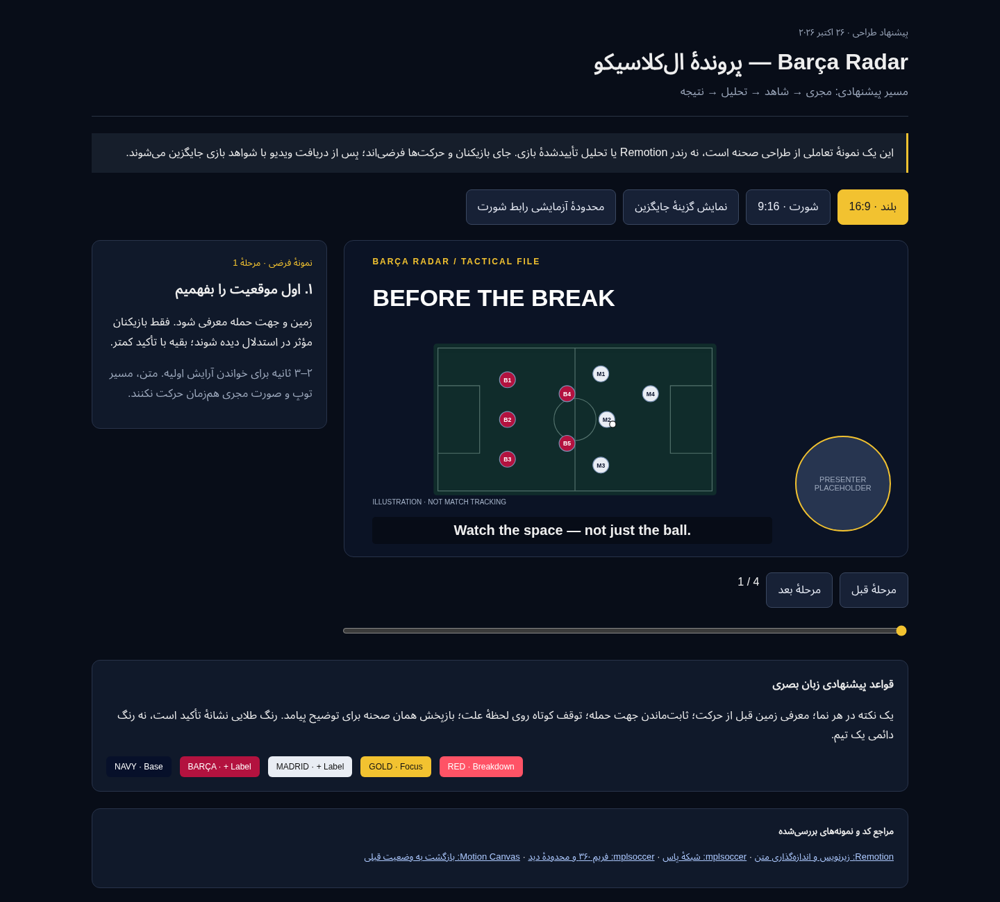

# Barça Radar — PSG 4–2 Barça: production packet

> این بسته آرشیو برنامهٔ سناریوی PSG است. کاربر بعداً گفتار واقعی فایل Drive را مبنا قرار داد؛ آن فایل تحلیل تاکتیکی ال‌کلاسیکوست و خروجی فعال در [clasico-source](../clasico-source/README.md) قرار دارد. فایل Drive، اجرای این سناریوی PSG نیست.

Updated: 2026-10-26. Planning language: Persian; spoken content and on-screen graphics: English.

**تصمیم کاربر:** با متن ارسالی تحلیل PSG پیش برویم. این قسمت دربارهٔ ال‌کلاسیکو نیست. متن گفتار مبنای ثابت تولید است؛ پیشنهادهای اصلاح متن در تحقیق قبلی، تغییر تأییدشدهٔ سناریو محسوب نمی‌شوند. یک بلند و یک شورت از همین روایت آماده می‌شوند.

این پوشه مرجع برنامه‌ریزی دو خروجی است. برنامه، تحقیق و نمونهٔ طراحی قابل استفاده‌اند؛ ویدیوی نهایی هنوز ساخته یا در Actions رندر نشده است. طرح‌های تصویری نمونه‌اند و شاهد واقعیِ موقعیت بازیکنان نیستند.

## مسیر خواندن

| فایل | کاربرد |
|---|---|
| [production-plan.fa.md](production-plan.fa.md) | تصمیم‌های نهایی طراحی، ساختار بلند/شورت و ترتیب تولید |
| [script.en.md](script.en.md) | متن ارسالی کاربر، شامل سؤال و پایان |
| [script-edit-plan.fa.md](script-edit-plan.fa.md) | تحلیل جمله‌به‌جمله و نیازهای شاهد؛ پیشنهادهای ویرایش متن اختیاری‌اند |
| [shot-list.csv](shot-list.csv) | ۵۰ واحد گفتارِ موجود، زمان مرجع و دستور اجرای هر نما |
| [graphics-and-sound.fa.md](graphics-and-sound.fa.md) | سیستم گرافیک، کپشن، موسیقی، افکت و متن روی تصویر |
| [short-plan.fa.md](short-plan.fa.md) | اجرای مستقل شورت؛ برش ۳۹ثانیه‌ای قبلی صرفاً پیشنهاد اولیه |
| [source-metadata.json](source-metadata.json) | مشخصات فایل دریافت‌شده؛ بدون لینک Drive یا فایل خام |
| [assets.json](assets.json) | دارایی‌های موجود/لازم و وضعیت هرکدام |
| [evidence-register.csv](evidence-register.csv) | ادعاها، وضعیت منابع و شیوهٔ نمایش |
| [render-handoff.fa.md](render-handoff.fa.md) | قرارداد جایگزینی ویدیو و راه تولید خروجی در GitHub Actions |
| [delivery-and-qc.fa.md](delivery-and-qc.fa.md) | خروجی‌ها، تامبنیل، متن انتشار و معیار کنترل کیفیت |
| [research/sources.md](research/sources.md) | منابع خارجی، دامنهٔ بررسی و برداشت قابل اجرا |
| [research/initial-visual-research.fa.md](research/initial-visual-research.fa.md) | تحقیق اولیه با فرض ال‌کلاسیکو؛ موضوع آن با تصمیم PSG جایگزین شده، اصول بصری معتبرند |
| [storyboard/index.html](storyboard/index.html) | نمونهٔ تعاملی بدون وابستگی خارجی؛ دانلود و در مرورگر باز شود |

## پیش‌نمایش طراحی

این تصویر فریم خروجی برنامه نیست. HTML همراه امکان تغییر مرحله، قاب عمودی و گزینهٔ تحلیلی را می‌دهد. رابط آن با مرورگر آزمایش شده است. برای دیدن نسخهٔ عمودی: [تصویر نمونه](storyboard/portrait.png).

## وضعیت واقعی

- وابستگی‌های Studio، TypeScript و bundle هر دو مخزن در onboarding موفق بودند.
- قالب HO-RADAR و تایم‌لاین مرجع 448.19ثانیه‌ای از قبل وجود دارند؛ تطبیق خودکار با فایل تازه تأیید نشده است.
- L01–L49، با L13b، مجموعاً ۵۰ واحد گفتارند. این مرجع پایان ضبط‌شدهٔ متن کاربر را ندارد.
- کاربر تأیید کرد فایل دریافت‌شدهٔ 175ثانیه‌ای، اجرای **شورت** است. اجرای بلند جداگانه ارسال می‌شود.
- پیشنهاد اولیهٔ L16–L19 با مدت مرجع 39.05s، تصمیم نهایی برای فایل شورت نیست؛ گفتار و تدوین شورت از اجرای مستقل خودش استخراج می‌شود. مدت منبع، مدت خروجی نهایی را تعیین نمی‌کند.
- تولید گرافیک نهایی، تطبیق تایم‌لاین، بررسی شواهد و اجرای Actions در مراحل بعدی‌اند.
- وضعیت دریافت فایل اصلی در [render-handoff.fa.md](render-handoff.fa.md) ثبت می‌شود. لینک خصوصی Drive و فایل خام در این پوشه منتشر نمی‌شوند.

ثبت این بسته در GitHub، تأیید کیفیت ویدیوی نهایی یا اجرای موفق رندر نیست.
