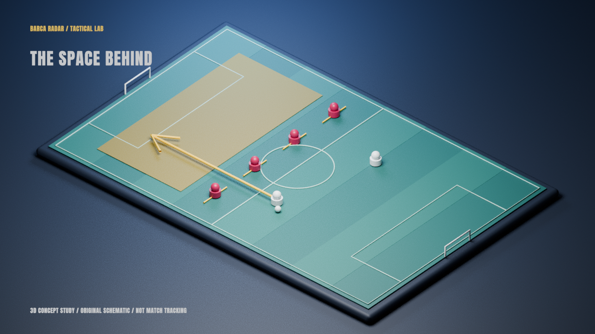

# Skill و MCP برای کیفیت بصری و تنوع محتوای Barça Radar

تاریخ بررسی: ۲۸ اکتبر ۲۰۲۶. خواستهٔ کاربر: انتخاب ابزار با توجه به **کیفیت قاب و تنوع روایت**؛ آسانی و سرعت تولید معیار دوم است. این سند بررسی و نقشهٔ توسعه است؛ اتصال سرویس، نصب Skill بیرونی یا موفقیت رندر آن سرویس را ادعا نمی‌کند.

## نتیجهٔ پیشنهادی

سه سرمایه‌گذاری بصری با پایهٔ فعلی بیشترین توجیه را دارند: **کارگردانی هنری و سیستم قاب‌ها؛ نقشه و مستند تصویری؛ آزمایشگاه تاکتیکی با نماهای سه‌بعدی منتخب.** شاخهٔ چهارم، پروندهٔ آماری، وقتی ارزشمند می‌شود که دادهٔ معتبر و مجازِ مورد نیاز قسمت واقعاً تأمین شود. تصویر مولد نیز برای سبک‌های تصویری و نماهای مکمل قابل بررسی است؛ کیفیت هر مدل باید روی نمونهٔ واقعی سنجیده شود.

نصب چند MCP به‌خودی‌خود زبان تصویری نمی‌سازد. Skill روش تحقیق، طراحی و کنترل کیفیت را توضیح می‌دهد؛ MCP راه دسترسی عامل به ابزار/سرویس است؛ موتورهایی مثل Remotion و Blender تصویر را می‌سازند. گاهی یک ابزار از CLI موجود قابل استفاده است و اتصال MCP تازه فقط تجربهٔ تعامل را عوض می‌کند. انتخاب نهایی باید با یک قاب و نمونهٔ کوتاه قابل قضاوت شود.

## نقطهٔ شروع واقعی پروژه

- موجود و آزمایش‌شده: Remotion4.0.535، FFmpeg، فونت‌های محلی، گرافیک تاکتیکی دوبعدی، قاب مجری/برد/عکس، کاتالوگ عکس و دو دموی تصویری رندرشده در GitHub.
- Blender4.3.2 روی همین محیط موجود است. یک **قاب ثابتِ شماتیک سه‌بعدی** با CLI بومی واقعاً رندر شد؛ MCP برای این آزمون لازم نبود. این نتیجه، آماده‌بودن خط تولید انیمیشن سه‌بعدی یا نصب افزونهٔ Blender MCP را ثابت نمی‌کند.
- ابزار داخلی تولید تصویر در فهرست ابزارهای این جلسه وجود دارد؛ بنابراین تولید یک تصویر ثابت لزوماً نیازمند افزودن یک سرویس تازه نیست. در این بررسی درخواست تولید تصویر به آن ارسال نشد.
- Canva، Higgsfield، Figma، Runway، Tavily، Exa و ElevenLabs در ابزارهای فعال این جلسه متصل نیستند. وجود Plugin پیشنهادی Figma به معنی نصب آن نیست. جست‌وجوی اسناد از شبکه با اتصال واقعی MCP تفاوت دارد.
- اتصال GitHub و مسیر رندر فعلی از قبل کار می‌کنند؛ افزودن GitHub MCP به‌تنهایی مدل تصویری تازه‌ای ایجاد نمی‌کند.

## مدل‌هایی که ارزش ساخت دارند

| خانوادهٔ پیشنهادی | بیننده چه تصویر متفاوتی می‌بیند؟ | قابلیت/اتصال مناسب | تصمیم فعلی |
|---|---|---|---|
| **استودیوی تحلیلی** | قاب مجری با سلسله‌مراتب مشخص، کارت چهره، شاهد بزرگ و جمع‌بندی کوتاه؛ چند چیدمان با هدف متفاوت | Figma MCP رسمی + Skill طراحی بصری + Remotion | اولویت بالا برای کیفیت همهٔ ویدیوها؛ بخش پایه موجود، طراحی سیستم کامل پیشنهاد است |
| **آزمایشگاه تاکتیکی سه‌بعدی** | زمین حجمی، دوربین مایل/کنار زمین، خط دفاع و فضای پشت آن؛ بازگشت به نمای بالا برای خواندن رابطه | Blender بومی؛ در صورت نیاز MCP for Blender؛ یا ThreeCanvas داخل Remotion | قاب ثابت آزمایش شد؛ انیمیشن و اتصال MCP هنوز آزمایش نشده‌اند |
| **مستند نقشه و آرشیو** | حرکت از اسپانیا به کاتالونیا، مسیر بازیکن/مربی، تاریخ و شهر، عکس و سند مرتبط با هر مقطع | Skill رسمی remotion-maps + MapLibre/GeoJSON + بانک عکس | اولویت بالا برای یک خانوادهٔ محتوایی مستقل؛ زمینهٔ آرشیو موجود، صحنهٔ نقشه تازه لازم است |
| **پروندهٔ بازیکن/استعدادیابی** | ترکیب پرتره با نمودار هم‌مقیاس، مناطق دریافت، شات‌مپ یا شبکهٔ پاس؛ هر نمودار جواب یک سؤال | API مجاز فوتبال + adapter داده + Skill روایت داده + Remotion | منبع، تعریف متریک و پوشش فصل باید اول تأمین شود؛ اتصال زنده برقرار نیست |
| **میکروآموزش تصویری** | یک مفهوم مثل cover shadow یا مثلث پاس، با تغییر شکل و نمایش مرحله‌ای علت/اثر | Remotion فعلی؛ Manim یا Motion Canvas برای نیاز هندسی پیچیده | بدون MCP هم ممکن است؛ موتور دوم فقط برای قابلیت مشخص انتخاب شود |
| **پروندهٔ انتقال و اقتصاد** | مسیر باشگاه‌ها روی نقشه، timeline مذاکره، تفاوت رقم قطعی/برآورد، جریان پول و اثر روی ترکیب | تحقیق Exa یا Tavily + گزارش مالی/منبع رسمی + نقشه و نمودار | خانوادهٔ محتوایی تازه؛ search API جای منبع معتبر یا قرارداد داده را نمی‌گیرد |
| **گزارش خبری روز** | عکس تازهٔ رویداد، کارت منبع و زمان، اثر خبر روی ترکیب؛ تفاوت بصری خبر با تحلیل بلند | Exa یا Tavily + عکس مجاز + منبع نتیجه/ترکیب | ارزش اتصال در تازگی و تنوع شاهد است؛ خود جست‌وجو گرافیک تولید نمی‌کند |
| **جستار تصویری و تیزر سینمایی** | تصویرسازی اختصاصی، فضای بصری نمادین، حرکت تصویر به ویدیو و گذارهای کوتاه | Runway MCP رسمی + Skillهای runway-media/workflows؛ fal API به‌عنوان مسیر جایگزین | نمونهٔ مولد هنوز ساخته/ارزیابی نشده؛ انتخاب مدل و هزینه باید در زمان اجرا بررسی شود |
| **مستند نریشن‌محور/چندزبانه** | آرشیو و داده بدون قاب دائمی مجری؛ ریتم صوت، سکوت و افکت مکمل تصویر | Skillهای رسمی ElevenLabs + API مناسب + تدوین فعلی | برای محتوای آینده مناسب؛ جایگزینی صدای اجرای موجود مجاز فرض نشده است |

تنوع محتوا از سؤال و شاهد متفاوت می‌آید: «چرا پرس شکست خورد؟»، «چرا این بازیکن با این نقش مناسب است؟»، «یک انتقال چه تغییری در هزینه و ترکیب ایجاد می‌کند؟»، «هویت باشگاه چگونه در شهر شکل گرفت؟». تغییر رنگ یا افزودن افکت به یک سناریوی ثابت، به‌تنهایی این تنوع را ایجاد نمی‌کند.

## بررسی اتصال‌ها و Skillهای مشخص

### ۱. Remotion Skills رسمی — هماهنگ با موتور فعلی

[مخزن رسمی](https://github.com/remotion-dev/skills) و فایل‌های `remotion-best-practices` و `remotion-maps` خوانده شدند. کاربرد مستقیم: typography، ترکیب صحنه، timing، کپشن، حرکت نقشه و مسیر. نسخهٔ Skill بررسی‌شده4.0.539 است و پروژه4.0.535؛ مثال‌های دارای API تازه باید با نسخهٔ نصب‌شده تطبیق داده شوند. این تحقیق بسته‌ها یا lockfile را ارتقا نداده است.

دستور رسمی نصب `npx skills add remotion-dev/skills` است؛ این دستور در این بررسی اجرا نشده است. در انتخاب بعدی، فقط Skillهای لازم به پروژه اضافه و نسخه/commit ثبت شوند؛ راهنمای کلی ناشر جای قواعد خاص این پروژه و دستور کاربر را نمی‌گیرد.

### ۲. Figma MCP رسمی — سیستم طراحی و قاب‌های متمایز

[راهنمای رسمی Figma](https://github.com/figma/mcp-server-guide) قابلیت خواندن screenshot، component، variable و design context را توضیح می‌دهد؛ قابلیت نوشتن روی canvas در remote server نیز در نسخهٔ فعلی مستند است. endpoint رسمی: `https://mcp.figma.com/mcp`.

ارزش پیشنهادی برای ما: طراحی سه خانوادهٔ frame، کارت بازیکن، lower-third، نمودار و thumbnail به‌صورت هماهنگ و با نسخهٔ عمودی مستقل؛ سپس پیاده‌سازی در Remotion. Figma موتور تدوین timeline یا تضمین تبدیل خودکار طرح به انیمیشن نیست. طرح/seat و rate limit اهمیت دارند؛ راهنمای فعلی محدودیت شدیدتر خواندن برای Starter/View/Collab و وضعیت beta برخی قابلیت‌ها را ذکر می‌کند. قیمت و سقف‌ها باید هنگام اتصال دوباره بررسی شوند.

صفحهٔ جداگانهٔ tools-and-prompts در این محیط403 گرفت؛ قابلیت‌های بالا از README رسمیِ قابل‌دسترسی نقل شده‌اند. Plugin پیشنهادی محیط وجود دارد، اما نصب یا OAuth انجام نشده است.

### ۳. Blender و MCP for Blender — عمق و کارگردانی دوربین

[Blender CLI رسمی](https://docs.blender.org/manual/en/latest/advanced/command_line/render.html) برای رندر برنامه‌پذیر خوانده شد. [MCP for Blender](https://github.com/ahujasid/mcp-for-blender) پروژهٔ **شخص ثالث** است، نه افزونهٔ رسمی بنیاد Blender. README فعلی تغییر نام package از `blender-mcp` به `mcp-for-blender` را اعلام می‌کند. ابزارها شامل اجرای Python داخل Blender، بازدید چند زاویه و بررسی فریم/رندر است؛ این امکانات به طراحی و بازبینی scene کمک می‌کنند.

برای Cloud همین CLI بومی مسیر سادهٔ تولید دارایی است. MCP به Blender در حال اجرا، addon و پل ارتباطی نیاز دارد؛ صرف نصب package آن را حاضر نمی‌کند. این پل طبق README اجرای Python دارد و socket پیش‌فرض آن احراز هویت ندارد؛ اگر بعداً استفاده شود، روی localhost محدود و قابلیت safe mode همان نسخه بررسی شود. در این تحقیق هیچ socket یا addon تازه فعال نشد.

[ادغام رسمی Three با Remotion](https://www.remotion.dev/docs/three) مسیر جایگزین است: `@remotion/three` و React Three Fiber، با انیمیشن وابسته به فریم. سازگاری نسخه‌ها و تنظیم renderer مانند ANGLE در GitHub باید عملاً سنجیده شوند. نتیجهٔ Blender ثابت، آزمون ThreeCanvas یا رندر انیمیشن محسوب نمی‌شود.

### ۴. Runway MCP رسمی — تصویر متحرک و جستارهای تصویری

[مخزن رسمی runwayml](https://github.com/runwayml/runway-mcp-plugin) و Skillهای `runway-media` و `runway-workflows` خوانده شدند. endpoint فعلی `https://mcp.runwayml.com/mcp` است. مستندات، تولید و ویرایش تصویر/ویدیو، image-to-video، گسترش قاب، چندشات و برخی ابزارهای صوتی را معرفی می‌کنند؛ مدل، ratio، مدت و credit واقعی باید از toolهای متصل در زمان اجرا خوانده شوند.

پیشنهاد بصری: یک تصویر مرجعِ طراحی‌شده، نماهای مکمل کوتاه با سبک هماهنگ، تیزر نمادین و روایت تصویرسازی‌شده. هدف ما برای این کاربرد، نمایش دقیق حرکت واقعی بازیکن یا ساخت مدرکِ یک اتفاق مسابقه نیست. حفظ هویت چهره، پیراهن، متن و تداوم حرکت نیاز به بازبینی خروجی واقعی دارد؛ چندشات‌بودن ابزار کیفیت و انسجام را تضمین نمی‌کند.

احراز هویت طبق مستندات OAuth است و تولید از اعتبار حساب استفاده می‌کند. حساب متصل یا generation اجرا نشده است. Plugin/endpoint رسمی پیدا شده، اما ابزار نصب Plugin این جلسه برای این سرویس فراهم نیست؛ اگر انتخاب شود، مسیر اتصال سازگار با کلاینت باید طی شود.

### ۵. fal — تنوع مدل از API، بدون نسبت‌دادن MCP غیررسمی

[مستندات رسمی fal](https://docs.fal.ai/) و index آن بررسی شدند: API/SDK برای مدل‌های تصویر، ویدیو، صدا و workflowهای مختلف. در جست‌وجوی انجام‌شده چند MCP جامعه پیدا شد؛ برای این بررسی یک MCP رسمی fal با قابلیت‌ها و نگهداری مشخص تأیید نشد. پیشنهاد ما در صورت انتخاب fal، adapter محدود به API رسمی است، تا انتخاب مدل، ورودی، هزینه و خروجی ثبت شوند. نام تجاری یک wrapper جامعه، رسمی‌بودن آن را ثابت نمی‌کند.

کیفیت بصری باید بین مدل‌های مشخص با brief و ورودی یکسان مقایسه شود؛ ادعای «بهترین مدل ویدیو» بدون آزمون مشترک مطرح نشده است. API مصرفی، شرایط هر مدل و طول/کیفیت خروجی جداگانه بررسی شوند. هیچ endpoint تولیدی فراخوانی نشده است.

### ۶. Manim و Motion Canvas — توضیح تصویری دقیق

[Manim Community](https://github.com/ManimCommunity/manim) برای انیمیشن برنامه‌پذیر آموزشی و [Motion Canvas](https://github.com/motion-canvas/motion-canvas) برای انیمیشن وکتورِ هماهنگ با نریشن بررسی شدند. این‌ها موتور/کتابخانه‌اند؛ استفاده از CLI یا کدشان الزاماً به MCP نیاز ندارد.

کاربرد برای ما: زاویهٔ پاس، سایهٔ پوشش، تغییر فاصلهٔ خطوط، هندسهٔ مثلث یا مقایسهٔ حرکت از نقطهٔ شروع یکسان. بسیاری از این نماها با Remotion فعلی نیز قابل ساخت‌اند؛ انتخاب موتور دوم باید با کیفیت یا قابلیت نمونهٔ واقعی توجیه شود، نه تعداد ابزار نصب‌شده. این دو موتور در این مرحله نصب/رندر نشدند.

### ۷. دادهٔ فوتبال — محتوای تازه از شواهد تازه

[StatsBomb Open Data](https://github.com/statsbomb/open-data) و `competitions.json` و [توافق استفادهٔ PDF](https://github.com/statsbomb/open-data/blob/master/LICENSE.pdf) بررسی شدند. ۸۰ رکورد رقابت/فصل در snapshot بود؛ فصل‌های لالیگا در این فایل عمدتاً تا2020/21 هستند و پوشش کامل زندهٔ لالیگای فعلی نیستند. مهم‌تر، §1.2.2 قرارداد، بهره‌برداری تجاری از داده یا تحلیل مشتق‌شده را منع می‌کند. attribution ذکرشده در README به‌تنهایی این محدودیت را رفع نمی‌کند. بنابراین برای آزمایش پژوهشی مفید است، اما مبنای خودکارِ مجاز برای کانال درآمدزا نیست.

برای گزارش تازه، [football-data.org](https://www.football-data.org/documentation/quickstart)، [API-Football](https://www.api-football.com/documentation-v3) و [Sportmonks](https://docs.sportmonks.com/football) مسیرهای قابل بررسی‌اند. documentation عمومی بررسی شد؛ account، plan، جزئیات قرارداد بازنشر، پوشش بازی مورد نظر و endpoint احرازشده آزموده نشدند. نتایج و standings با tracking، xG، xGOT یا دادهٔ رویداد کامل یکسان نیستند. صفحهٔ terms پیشنهادی football-data.org در مسیر آزموده‌شده404 داد؛ مجوز انتشار از آن نتیجه‌گیری نشده است. صفحهٔ API-Football shell راهنمای عمومی بود و همهٔ endpointها از آن خوانده نشدند.

برای renderer، یک JSON تأییدشده و دارای provenance ورودی باشد؛ درخواست live هنگام رندر هر فریم انجام نشود. API از پشت adapter محدود استفاده شود؛ «MCP فوتبال» نامعتبر یا scraper یک سایت، جای قرارداد داده را نمی‌گیرد.

### ۸. Exa یا Tavily — انتخاب یکی برای تحقیق، با اثر غیرمستقیم بصری

[Exa MCP رسمی](https://github.com/exa-labs/exa-mcp-server) و [Tavily MCP رسمی](https://github.com/tavily-ai/tavily-mcp) بررسی شدند. قابلیت‌های مستند: جست‌وجو، دریافت محتوای صفحه و تحقیق؛ Tavily همچنین map/crawl وب‌سایت را معرفی می‌کند. این map با نقشهٔ جغرافیایی ویدیو فرق دارد. endpointهای معرفی‌شده: `https://mcp.exa.ai/mcp` و `https://mcp.tavily.com/mcp`.

ارزش برای خبر/مستند: یافتن سند، نقل‌قول، منبع اصلی و تصویر نامزد تازه؛ سپس تأیید همان منبع. پیدا شدن URL عکس مجوز استفاده نمی‌دهد. به‌جای اتصال هر دو از ابتدا، یکی با کیفیت نتایج روی موضوع واقعی آزمایش شود. هیچ جست‌وجوی احرازشده یا MCP از این دو در این بررسی متصل نشد.

### ۹. ElevenLabs — تنوع روایت و طراحی صدا

[Skillهای رسمی ElevenLabs](https://github.com/elevenlabs/skills) شامل text-to-speech، dubbing، sound-effects، music و voice-isolator است. اثر مستقیم آن بیشتر بر تجربهٔ شنیداری و امکان مستند نریشن‌محور است؛ مکمل کارگردانی تصویر محسوب می‌شود. Skillهای صوت می‌توانند با API رسمی استفاده شوند.

[مخزن MCP محلی قدیمی](https://github.com/elevenlabs/elevenlabs-mcp) اکنون خود را deprecated معرفی و [سرور hosted](https://elevenlabs.io/docs/agents-platform/operate/hosted-mcp) را توصیه می‌کند. صفحهٔ hosted مدیریت agent و تولید TTS را مستند می‌کند؛ نباید از این امر نتیجه گرفت که تمام قابلیت‌های SFX/music/dubbing همان‌جا ابزار MCP فعال دارند. برای هر قابلیت، endpoint/API و شرایط حسابِ همان مسیر بررسی شود. هیچ کلیدی وارد یا صدایی تولید نشد. برای اجرای موجود کاربر، صدای اصلی و timeline حفظ می‌شوند مگر خود کاربر ویرایش دیگری بخواهد.

## دو Skill اختصاصی اضافه‌شده به مخزن

- [barca-visual-direction](../../.agents/skills/barca-visual-direction/SKILL.md): انتخاب زبان تصویری، سه style frame، shot map، معیار انتخاب ابزار، خوانایی و ثبت شواهد prototype.
- [football-data-story](../../.agents/skills/football-data-story/SKILL.md): سؤال آماری، پوشش و مجوز، تعریف متریک، مقایسهٔ هم‌مقیاس، provenance و اتصال دادهٔ ثابت به تصویر.

این دو، فایل دستورالعمل پروژه‌اند؛ خودشان API، MCP، مدل ویدیو یا renderer نصب نمی‌کنند. عامل Cloud باید آن‌ها را همراه `video-production` بخواند. Skillهای رسمی بیرونی در این مرحله نصب نشده‌اند.

## آزمایش سه‌بعدی انجام‌شده

[قاب واقعی رندرشده با Blender](previews/tactical-lab-3d.png) از مدل‌های هندسی ساخته‌شده در همین پروژه است. [اسکریپت اختیاری](../../tools/video/experiments/pitch_3d.py) فقط یک تصویر شماتیک می‌سازد؛ نقش بازیکن و مسیر، دادهٔ مسابقه یا tracking نیست. خروجی اولیه1280×720، Cycles روی CPU با48sample و4thread بود. نسخهٔ این Blender پشتیبانی OpenImageDenoise نداشت؛ denoise غیرفعال شد و رندر تازه واقعاً بررسی شد. رندر قاب نهایی در log بلندر28.98ثانیه طول کشید؛ [اندازه‌گیری و hash تصویر](tactical-lab-3d-proof.json) ثبت شده است. این شاهد، benchmark انیمیشن یا کیفیت نهایی متحرک نیست.

```sh
blender --background --factory-startup --python-exit-code 1 --threads 4 \
  --python tools/video/experiments/pitch_3d.py -- \
  --output /tmp/tactical-lab.png --samples 48
```



## برنامهٔ پیشنهادی اجرا و معیار کیفیت

1. **سیستم قاب و مستند نقشه‌ای:** Skill طراحی بصری + Skillهای مرتبط Remotion؛ Figma در صورت اتصال. سه style frame متمایز در16:9 و9:16، سپس یک برش کوتاه از آرشیو/نقشه/مجری. معیار: سلسله‌مراتب روشن، رنگ/فونت یکدست و شاهد مرتبط با جمله.
2. **تاکتیک سه‌بعدی منتخب:** یک مکانیزم با نمای بالا و نمای مایل؛ ابتدا still سپس یک نما با camera move کوتاه. معیار: عمق واقعاً به فهم کمک کند، فلش/ناحیه در موبایل خوانا باشد و زمان/هزینهٔ رندر ثبت شود. هیچ عدد افزایش retention از این مرحله استنتاج نمی‌شود.
3. **پروندهٔ بازیکن با دادهٔ مجاز:** یک سؤال، یک snapshot مجاز و دو نمودار قابل مقایسه. معیار: متریک/واحد/بازه/دقایق و منبع واضح؛ نمودارها به اصل داده ختم شوند و missing صفر فرض نشود.
4. **جستار تصویری مولد:** پس از انتخاب provider و حساب، یک style frame و نماهای مکمل کوتاه با ورودی یکسان آزمایش شوند. معیار: ثبات تصویر، حرکت، متن/چهره، تناسب با روایت و هزینهٔ خروجی پذیرفته‌شده، نه هزینهٔ یک generation موفق ظاهری.

برای انتخاب اول، Remotion Skills + دو Skill اختصاصی کمترین تغییر در زیرساخت را دارند؛ Figma کیفیت طراحی مشترک را هدف می‌گیرد؛ Blender ظرفیت عمق و دوربین را باز می‌کند؛ نقشه یک خانوادهٔ روایی مستقل می‌دهد. Runway انتخاب اختیاری برای سبک تصویرسازی/سینمایی است. ابزار تحقیق، Drive یا GitHub می‌تواند فرایند را بهتر کند، اما به‌اندازهٔ این چهار مسیر زبان تصویری تازه ایجاد نمی‌کند.

## حدود تأیید و ادامه در Cloud

[رسید منابع تحقیق](creative-integration-sources.json) URL، زمان بررسی، وضعیت دریافت و hash محتوای دریافت‌شده را ثبت می‌کند. خواندن مستندات به معنی audit کامل سرور، آزمون کیفیت مدل یا دسترسی حساب نیست. صفحه‌های403/404 و مسیرهای منسوخ در رسید حفظ شدند تا دوباره به‌اشتباه پیشنهاد نصب نشوند.

فایل تنظیمات MCP کلاینت یا credential محیط تغییر نکرده است. فعال‌سازی سرویس‌های انتخابی به مسیر اتصال همان کلاینت و احراز هویت لازم وابسته است؛ نوشتن یک URL در مستندات ابزارها را به این جلسه اضافه نمی‌کند. هیچ اشتراک خریداری، credit تولید مصرف، حساب متصل یا پست عمومی منتشر نشده است. این گزارش و دو Skill و آزمایش ثابت، کار تکمیل‌شدهٔ این مرحله‌اند؛ دموی انیمیشن، نقشه و دیتاست مجاز مراحل پیشنهادی‌اند.

## تکمیل بررسی با درخواست بعدی کاربر

[ارزیابی اختصاصی Canva و Higgsfield](canva-higgsfield-evaluation.fa.md) مسیر رسمی هر دو، تفاوت Canva MCP/Dev MCP و وابستگی برخی workflowهای Higgsfield به After Effects را بررسی می‌کند. Canva برای بستهٔ طراحی و Higgsfield برای تنوع سبک تصویر/حرکت نامزدهای مشخص‌اند؛ هیچ‌کدام در این جلسه متصل نشده‌اند.
