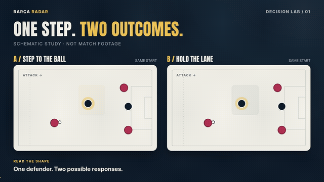
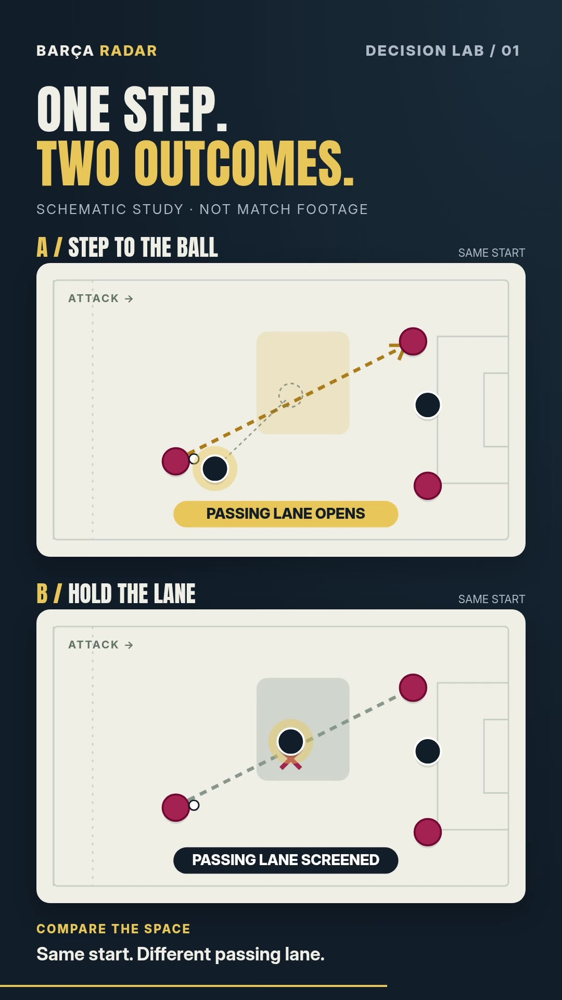

# نمونهٔ طراحی «یک تصمیم، دو مسیر»

۲۹ اکتبر۲۰۲۶. یک مطالعهٔ مستقل از مدل **Decision Lab** با دو خروجی واقعی۱۶ثانیه‌ای ساخته شد. هدف، مقایسهٔ دو انتخاب از هندسهٔ شروع یکسان است: مدافع به توپ نزدیک شود یا مسیر پاس را پوشش دهد. وضعیت‌ها شماتیک و فرضی‌اند؛ نتیجهٔ بازی واقعی یا احتمال گل مدل‌سازی نشده است.



[فریم افقی با وضوح کامل](previews/final-upgrade-2026-10-29/decision-lab-study-11.jpg). GIF پیش‌نمایش640px/10fps از همان MP4 است؛ فایل اصلی Full HD/30fps است.

## طراحی

| زمان | عمل تصویری | هدف |
|---|---|---|
|0–3s|دو وضعیت شروع یکسان؛ مدافع مورد نظر برجسته|شناخت رابطه|
|3–5s|مکث و طرح انتخاب|فرصت نگاه‌کردن|
|5–9s|فقط مدافع مسیرA حرکت می‌کند|مقایسهٔ کنترل‌شده|
|9–13s|مسیر پاس و پیامد دو انتخاب ظاهر می‌شود|خواندن اثر تصمیم|
|13–16s|جمع‌بندی کوتاه روی تصویر ثابت|تثبیت نکته|

قاب افقی دو پنل کنار هم و قاب عمودی دو پنل روی هم دارد؛ نسخهٔ عمودی crop نسخهٔ افقی نیست. همهٔ عناصر با frame محاسبه می‌شوند. کد اصلی است و از فوتیج، چهره یا صدای کسی استفاده نمی‌کند. پس‌زمینهٔ روشن برد، labelهای محدود و حرکت کمتر برای مشاهدهٔ مکانیزم انتخاب شدند.



## وضعیت واقعی و محدودیت

- هر دو فایل H.264/yuv420p/BT.709،30fps و۴۸۰فریم‌اند:1920×1080 و1080×1920.
- هر دو کامل decode شدند؛ فریم‌های2،7،11 و15ثانیه استخراج و قاب‌های نماینده بازبینی شدند.
- خروجی‌ها **بی‌صدا** هستند: مطالعهٔ ترکیب‌بندی و حرکت؛ نسخهٔ آمادهٔ انتشار یا جایگزین اجرای مجری نیستند.
- hash و مشخصات فایل‌ها در [decision-lab-proof.json](decision-lab-proof.json) است. MP4ها عمداً زیر `studio/out/decision-lab-study/` و خارج Git هستند؛ این رندرها محلی‌اند، Actions تازه نیستند.
- در مرحلهٔ اول، labelِ پنلB از کپسول بیرون می‌زد؛ عرض اصلاح و رندر نهایی دوباره ساخته شد. در نسخهٔ عمودی فاصلهٔ عنوان و پنل نیز تنظیم شد.
- پیش‌نمایش۳۶۰px نیز باز شد: عنوان و رابطه قابل تشخیص‌اند، اما متنِ فرعی کوچک است و مقایسهٔ هم‌زمان هنوز اطلاعات دو پنل را می‌طلبد؛ آزمایش بعدی نسخهٔ A سپسB با بازگشت به قاب مشترک است. این مطالعه اثبات بهبود retention نیست.

## اجرای دوباره

از `studio/` و پس از نصب lockfile:

```sh
npm run typecheck
npx remotion studio src/experiments/index.tsx
npx remotion render src/experiments/index.tsx DECISION-LAB-STUDY out/decision-lab-study/DECISION-LAB-STUDY.mp4 --codec=h264 --pixel-format=yuv420p --color-space=bt709 --image-format=png --concurrency=2 --crf=18
npx remotion render src/experiments/index.tsx DECISION-LAB-STUDY-VERTICAL out/decision-lab-study/DECISION-LAB-STUDY-VERTICAL.mp4 --codec=h264 --pixel-format=yuv420p --color-space=bt709 --image-format=png --concurrency=2 --crf=18
```

در این Cloud از `--browser-executable=/usr/bin/chromium` استفاده شد؛ در محیط دیگر مسیر واقعی مرورگر انتخاب شود. entrypoint مستقل است تا رندر آزمایش به رسانهٔ آرشیویِ قسمت فعال وابسته نشود. دو اجرای هم‌زمان هشدار race در cacheِ Webpack دادند، اما هر دو فایل خروجی سالم و decode موفق داشتند؛ برای تکرار ساده، دستورهای بالا ترتیبی اجرا شوند.

## معیار اتصال به تولید

اول یک مسئله و جملهٔ واقعیِ مناسب انتخاب شود. هندسه و فرض‌ها بازبینی شوند، زمان cueها به source وصل شود، caption و صدای مجری حفظ شوند و مقایسه در موبایل تست شود. اگر بدیل در گفتار توضیح داده نشده، آن را بی‌توضیح به تحلیل موجود وارد نکنیم. مسیر اجرایی در [طرح مدل‌ها](visual-models-blueprint-2026-10-29.fa.md) آمده است.
