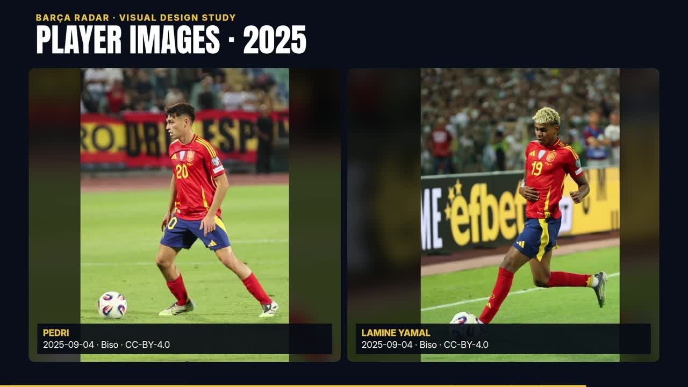

# تحویل نمونه‌های تصویری — ۲۸ اکتبر ۲۰۲۶

[اجرای موفق GitHub شماره40611256947](https://github.com/ashkan244/barca-yt-render/actions/runs/40611256947) روی commit `e56b6a7fe1025a0a88ce1bede56ce5ab2db3cf3c` دو نمونهٔ مستقل۲۷ثانیه‌ای را رندر کرد:

- [دانلود نمونهٔ افقی و گزارش‌ها](https://github.com/ashkan244/barca-yt-render/actions/runs/40611256947/artifacts/12783556764): `PHOTO-MODELS-DEMO`، ابعاد1920×1080.
- [دانلود نمونهٔ عمودی و گزارش‌ها](https://github.com/ashkan244/barca-yt-render/actions/runs/40611256947/artifacts/12782738369): `PHOTO-MODELS-DEMO-VERTICAL`، ابعاد1080×1920.

هر بسته شامل MP4، گزارش QC، contact sheet و اعتبار کامل عکس‌هاست. زمان کل job افقی3دقیقه3ثانیه و عمودی4دقیقه29ثانیه بود؛ این‌ها benchmark خالص رندر نیستند. Artifactها تا۲۷نوامبر۲۰۲۶ نگهداری می‌شوند؛ برای آرشیو دائمی باید دانلود شوند.

هر دو artifact جدا دانلود شدند و decode کامل و ساختار دوباره بررسی شد: 30fps، H.264/yuv420p/BT.709، ۸۱۰فریم، صدای AAC و مدت container حدود27.008s. contact sheet و فریم معرفی پدری/یامال باز شدند. SHA-256، اندازه، جزئیات تصویر و اندازه‌گیری صدا در [گزارش تحویل ماشینی](photo-demo-delivery.json) ثبت‌اند.

زیرصدای این دمو بدون گفتار، موسیقی آرامِ تولیدشدهٔ پروژه است؛ اندازه‌گیری آن حدود−36.83LUFS است و با مستر گفتارِ هدف−16LUFS یکسان فرض نشده است. این دمو برای بررسی قالب‌های تصویری است و به‌عنوان قسمت محتوایی آمادهٔ پست معرفی نمی‌شود.

ترتیب نمونه: پرترهٔ کرایف۱۹۸۸؛ مقایسهٔ دو مقطع۱۹۷۳/۱۹۸۸؛ عکس کامل و جزئیات روزنامه؛ پروندهٔ مادرید۱۹۵۹؛ معرفی پدری/یامال با عکس۲۰۲۵. تاریخ واقعی عکس‌ها و اعتبار عکاس نمایش داده می‌شوند. تصاویر دو بازیکن، مربوط به تیم ملی‌اند و شاهد ال‌کلاسیکوی مورد تحلیل نیستند.

[فریم واقعی خروجی عمودی](previews/player-images-vertical.jpg) · [راهنمای منابع و عکس روز](photographic-production.fa.md) · [کاتالوگ اعتبار عکس‌ها](photo-credits.md)

مستر کامل۱۷۵ثانیه‌ایِ قالب تطبیقی در این اجرا رندر نشده است؛ خروجی قبلی شورت، نسخهٔ دیگری است. این تحویل، نام حل‌نشدهٔ Bernardo/Bernal را تأیید نمی‌کند و هیچ پست عمومی در شبکهٔ اجتماعی انجام نشده است.
